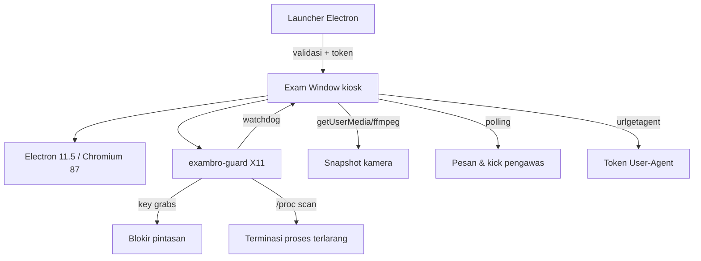

# ExamBro Client untuk LInux / Linux Mint

Port Linux dari **ExamBrowser Client 26.0222** (Pusmenjar/Pusdatin) untuk menggantikan klien Windows pada ujian ANBK/Asesmen Nasional.

Aplikasi ini membawa alur ujian, validasi perangkat, kamera, pesan pengawas, dan pengaman kiosk ke Linux Mint, dengan padanan Linux untuk pemblokiran pintasan, pemantauan proses, serta watchdog.

<p>
  
  
  
  
  
</p>

> Proyek ini **tidak berafiliasi resmi** dengan Pusmenjar/Kemendikbud. Gunakan hanya pada komputer ujian yang Anda kelola, dengan persetujuan peserta.
> Aplikasi ini memantau proses, memblokir pintasan, dan dapat merekam kamera.
> Baca bagian [Privasi dan batasan](#privasi-dan-batasan) sebelum digunakan.

---

## Daftar isi

- [Sorotan](#sorotan)
- [Instalasi cepat](#instalasi-cepat)
- [Menjalankan](#menjalankan)
- [Password dan keluar](#password-dan-keluar)
- [Error 402](#error-402-browser-anda-tidak-memiliki-akses)
- [Pengaturan](#pengaturan)
- [Fitur](#fitur)
- [Arsitektur](#arsitektur)
- [Build dari source](#build-dari-source)
- [Troubleshooting](#troubleshooting)
- [Privasi dan batasan](#privasi-dan-batasan)
- [Kredit](#kredit)

---

## Sorotan

- Launcher dengan pemeriksaan OS, arsitektur, CPU, RAM, resolusi, jumlah monitor, sesi remote, sound card, kamera, dan koneksi.
- Mode **Daring** dan **Semi Daring**.
- Kiosk layar penuh, selalu di atas, tanpa menu/taskbar.
- Anti-tutup: close button, `Alt+F4`, dan `app.quit` dicegah; keluar hanya dengan password; browser di-restart oleh guard jika mati.
- Blokir `Alt+Tab`, `Super`, `Ctrl+C/V/X/A`, `Ctrl+P/S/O/T/N/W/Q`, `PrintScreen`, `F1`–`F12`, dan kombinasi lain dari klien asli.
- Watchdog proses: browser/aplikasi ujian di-restart; aplikasi terlarang dihentikan selama ujian.
- Kamera: persetujuan, snapshot 640×480 berkala, simpan lokal, upload opsional.
- Polling pesan pengawas dan status tendangan.
- **Token User-Agent ExamBro** untuk menembus gerbang server (fix **Error 402**).
- Halaman 404 + F5, zoom `Ctrl+=/-/0`, download ke `~/Downloads/ExamBro`, UA resmi, abaikan sertifikat server lokal.
- Settings terenkripsi AES-256-CBC, kompatibel dengan `setting_exambro.json` asli.
- Integritas file SHA-256 dan logging lokal.

---

## Instalasi cepat

### Opsi 1 — Paket `.deb` (disarankan)

Unduh `exambro-client_26.0222_amd64.deb` dari halaman **[Releases](../../releases/latest)**, lalu:

```bash
sudo apt install ./exambro-client_26.0222_amd64.deb
```

Jalankan:

```bash
exambro
```

atau dari menu **ExamBro Client**.

Uninstall:

```bash
sudo apt remove exambro-client
```

### Opsi 2 — Installer portable (tanpa root)

Ekstrak folder proyek, lalu:

```bash
chmod +x install.sh uninstall.sh
./install.sh
```

Installer menyalin aplikasi ke `~/.local/opt/exambro`, membuat perintah
`~/.local/bin/exambro`, dan entri menu aplikasi.

```bash
~/.local/bin/exambro
```

### Verifikasi paket

```bash
sha256sum exambro-client_26.0222_amd64.deb
```

Bandingkan dengan SHA-256 paket yang disertakan:

```text
6ca7ff0c8893e818c743da5fd2c2a93dac987de79ae6861b4170fdfd0e89b68a  exambro-client_26.0222_amd64.deb
```

> Jika Anda membangun ulang paket, hash akan berubah. Perbarui `dist/SHA256SUMS`
> dengan `sha256sum exambro-client_26.0222_amd64.deb > dist/SHA256SUMS`.

---

## Menjalankan

1. Pastikan sesi desktop memakai **X11 Cinnamon** (bukan Wayland) untuk hasil pengaman terbaik.
2. Hubungkan kamera jika sekolah mewajibkan (`aktifkamera=1`).
3. Jalankan `exambro`.
4. Pilih **Daring** atau **Semi Daring**.
5. Tunggu semua pemeriksaan berstatus siap.
6. Klik **RUN**.
7. Jika kamera diwajibkan, setujui dialog perekaman.
8. Login dengan akun peserta pada halaman ANBK.

---

## Password dan keluar

| Peran | Password default |
|---|---|
| Proktor | `12345` |
| Admin | `admin` |

**Ganti kedua password sebelum digunakan** melalui **Pengaturan Pengawas**.

Keluar dari ujian:

1. Tekan dan tahan `Ctrl`, tekan `C`, lalu `B` (`Ctrl+C+B`).
2. Masukkan password proktor/admin.
3. Aplikasi menutup ujian dan memulihkan pengaturan desktop.

Alternatif: `Ctrl+Alt+Q` membuka dialog password.

---

## Error 402: “Browser anda tidak memiliki akses”

Server ANBK tidak menerima User-Agent browser biasa. Klien resmi meminta
**token User-Agent** ke endpoint `urlgetagent`, lalu mengirim token terenkripsi
sebagai header `User-Agent`. Tanpa token ini server mengalihkan ke
`/Home/InvalidBrowser` dan menampilkan **ERROR 402**.

Port ini melakukan hal yang sama:

1. GET `urlgetagent` dengan header otorisasi klien Radyalabs.
2. Ambil `payload.userAgent` (JWT).
3. Enkripsi AES-256-CBC + Base32 dengan `passPhraseOnline` dari klien asli.
4. Set token hasil enkripsi sebagai `User-Agent` untuk jendela ujian.

Opsi **Gunakan token User-Agent ExamBro** di Pengaturan aktif secara default.
Jika server mengembalikan `InvalidBrowser`, aplikasi otomatis meminta token baru
dan memuat ulang halaman (maksimal 3 percobaan).

Jika masih 402:

- Pastikan `urlgetagent` benar dan dapat diakses:
  `https://anbk-webapi.pusmendik.kemendikdasmen.go.id/auth/api/v1/user-agent/generate`
- Pastikan komputer/IP sudah terdaftar di server sekolah.
- Pastikan jam komputer sesuai; token JWT memiliki masa berlaku.
- Jangan mematikan opsi token User-Agent.
- Untuk **Semi Daring**, server lokal/VHD dapat memakai mekanisme token sendiri;
  alur ini belum diuji terhadap server VHD.

---

## Pengaturan

Buka **Pengaturan Pengawas** dari launcher, lalu masukkan password.

| Bagian | Isi |
|---|---|
| Utama | Nama aplikasi, versi, password proktor/admin, jenis apps, kegiatan |
| URL & Server | URL daring, semi daring, FR, agent, cek internet |
| Validasi | Resolusi/RAM minimum, monitor, cek waktu, mode semi ketat, token UA |
| Kamera | Device, resolusi snapshot, interval, upload, persetujuan |
| Pengaman | Daftar proses terlarang, unlock keys, keybinding, anti-close |
| Lainnya | Sharing session, parameter, desktop, log level |

Perubahan disimpan terenkripsi. Jika folder instalasi read-only (misalnya
`/opt/exambro`), konfigurasi disimpan ke
`~/.config/ExamBro/setting_exambro.json` dan otomatis diprioritaskan.

### Variabel lingkungan

| Variabel | Fungsi |
|---|---|
| `EXAMBRO_NO_GUARD=1` | Jalankan tanpa guard native |
| `EXAMBRO_CONFIG=/path/file.json` | Pakai konfigurasi lain |
| `EXAMBRO_TEST_URL=file://...` | URL uji/smoke |
| `EXAMBRO_SMOKE=1` | Uji otomatis lalu keluar |
| `EXAMBRO_SMOKE_HOLD=1` | Tahan jendela smoke 60 detik |
| `EXAMBRO_FAKE_CAMERA=1` | Kamera palsu Chromium untuk pengujian |
| `EXAMBRO_OPEN_SETTINGS=1` | Buka settings saat mulai (uji UI) |
| `EXAMBRO_SKIP_INTEGRITY=1` | Lewati manifest (hanya debugging) |
| `EXAMBRO_MANAGE_KEYBINDINGS=0` | Jangan ubah keybinding desktop |
| `EXAMBRO_DEBUG=1` | Log debug |

---

## Fitur

### Pemeriksaan perangkat

- OS Linux Mint/Ubuntu/Debian, arsitektur 64-bit, CPU, RAM minimal 1 GB.
- Resolusi minimal 1024×720 dan satu monitor.
- Deteksi sesi remote (SSH/RDP/VNC/TeamViewer/AnyDesk/RustDesk).
- Deteksi kamera dan sound card.
- Probe internet dan server semi daring.
- Deteksi tanggal/jam server (opsional).
- Integritas file aplikasi, guard, dan runtime browser.

### Kiosk dan anti-mencontek

- Fullscreen + always-on-top + skip taskbar.
- Close/quit dicegah; password untuk keluar.
- Guard X11 menangkap pintasan dan memfokuskan jendela ujian.
- Proses terlarang dihentikan selama ujian: browser lain, remote desktop,
  screenshot/recorder, office, terminal, file manager, VM, chat.
- Deteksi `PrintScreen`, sembunyikan jendela, dan kosongkan clipboard.
- Watchdog me-restart browser jika proses mati tanpa izin.
- Monitor IP/lokal untuk mode semi daring.

### Ujian

- User-Agent resmi + token ExamBro.
- Abaikan sertifikat server lokal.
- Izin kamera/mikrofon.
- Username peserta dari halaman/header.
- Status ujian `username.json`.
- Polling pesan dan status tendangan pengawas.
- Halaman 404 + F5 retry.
- Zoom `Ctrl+=/-/0`.
- Download ke `~/Downloads/ExamBro`.

### Kamera

- Persetujuan peserta.
- Snapshot 640×480 (dapat diubah).
- Disimpan lokal di `~/.config/ExamBro/state/ImageCapture/`.
- Upload opsional ke endpoint FR/lokal dengan field yang sama seperti klien asli.

---

## Status pengujian

| Komponen | Status |
|---|---|
| Launcher & pemeriksaan perangkat | ✅ Diuji di Linux Mint 22.3 X11 |
| Kiosk fullscreen + anti-close | ✅ Diuji |
| Blokir `PrintScreen` | ✅ Diuji |
| Unlock `Ctrl+C+B` + password | ✅ Diuji |
| Kamera (fake device Chromium) | ✅ Menghasilkan JPEG 640×480 |
| Settings + enkripsi konfigurasi | ✅ Diuji |
| 404 + F5 retry | ✅ Diuji |
| Integritas 15 file | ✅ Lulus |
| Token User-Agent / fix 402 | ✅ Halaman login ANBK tampil |
| Polling pesan/kick server asli | ⚠️ Mengikuti endpoint asli, belum diuji produksi |
| Upload kamera ke server FR | ⚠️ Opsional, belum diuji produksi |

## Arsitektur



```text
exambro-linux/
├── app/                     # source Electron (main, config, agent, kamera, server)
├── bin/exambro-guard        # supervisor C + X11 key grabs + process watcher
├── runtime/                 # Electron 11.5 + setting_exambro.json
├── packaging/build-deb.sh   # builder .deb
├── install.sh               # installer portable
├── uninstall.sh
├── docs/README-LOCAL.md     # dokumentasi pengembangan lengkap
└── analysis/                # hasil rekayasa balik & checklist fitur
```

---

## Build dari source

Prasyarat:

- Linux Mint 22.x / Ubuntu 24.04 amd64
- `gcc`, `libx11-dev`, `libxrandr-dev`
- Node.js (untuk regenerasi manifest; runtime Electron sudah disertakan)
- `dpkg-deb`
- `ffmpeg`, `curl`, `gsettings`

Build guard:

```bash
gcc -O2 -o bin/exambro-guard bin/exambro-guard.c -lX11 -lXrandr
```

Build `.deb`:

```bash
./packaging/build-deb.sh
```

Hasil:

```text
dist/exambro-client_26.0222_amd64.deb
```

Regenerasi manifest integritas:

```bash
node packaging/make-integrity.js app runtime .
```

Menjalankan mode pengembangan:

```bash
./run-dev.sh          # dengan guard X11
./run-dev-noguard.sh  # tanpa guard, hanya debugging
```

Smoke test tanpa server:

```bash
EXAMBRO_NO_GUARD=1 EXAMBRO_SMOKE=1 \
EXAMBRO_TEST_URL="file://$PWD/app/pages/smoke.html" \
./runtime/exambrowser --no-sandbox --disable-dev-shm-usage
```

---

## Troubleshooting

### Error 402 / “Browser anda tidak memiliki akses”

Lihat bagian [Error 402](#error-402-browser-anda-tidak-memiliki-akses).
Pastikan opsi token UA aktif, `urlgetagent` benar, IP terdaftar, dan jam sesuai.

### Aplikasi tidak mau menutup

Itu memang perilaku anti-close. Gunakan `Ctrl+C+B` lalu password.
Jika guard macet, keluar dari sesi atau hentikan proses `exambro-guard` dari TTY.

### Layar tidak fullscreen / panel terlihat

Pastikan memakai **X11 Cinnamon**, bukan Wayland. Di Wayland, global key grab
dan always-on-top dibatasi compositor.

### Kamera tidak terdeteksi

```bash
ls -l /dev/video*
ffmpeg -f v4l2 -i /dev/video0 -frames:v 1 /tmp/cam.jpg
```

Set `cameraDevice` di Pengaturan. Jika kamera dipakai aplikasi lain, tutup
aplikasi tersebut.

### Keyboard tidak bisa mengetik

Jalankan `./bin/restore-keybindings.py` jika keybinding desktop tertinggal
karena proses dibunuh paksa. Guard juga mencoba memulihkannya saat mulai.

### Log

```bash
tail -f ~/.config/ExamBro/logs/exambro.log
```

### Build ulang manifest

```bash
node packaging/make-integrity.js app runtime .
```

---

## Privasi dan batasan

1. **Screenshot tidak bisa dilarang 100% di Linux.** Aplikasi memblokir
   `PrintScreen`, menyembunyikan jendela, mengosongkan clipboard, dan
   menghentikan alat screenshot/recorder yang dikenal. Root, kamera eksternal,
   atau perekam hardware tetap dapat mengambil gambar.
2. **Wayland** membatasi global key grab/focus. Gunakan X11 Cinnamon.
3. **Ctrl+Alt+Del**, VT switch, dan magic SysRq ditangani kernel; tidak dapat
   diblokir oleh aplikasi user-space.
4. **Root** selalu dapat mematikan guard atau mengubah konfigurasi.
5. **Kamera** dapat dicabut/ditutup fisik.
6. **Membunuh shell/explorer** tidak dilakukan karena merusak sesi Cinnamon;
   fullscreen + always-on-top dipakai sebagai gantinya.
7. **Updater otomatis** dari `ExamBrowser.exe` tidak disertakan.
8. **Polling pesan/kick dan upload kamera** mengikuti endpoint klien asli, tetapi
   belum diuji terhadap server produksi/sekolah. Uji di lingkungan ujian sebelum
   dipakai massal.
9. **Electron dijalankan dengan `--no-sandbox`** agar kompatibel dengan instalasi
   user tanpa setuid root. Ini menurunkan isolasi Chromium; jangan membuka situs
   tidak tepercaya di luar alur ujian.
10. **Pintasan desktop**: opsi `manageKeybindings` mengubah sementara pengaturan
    Cinnamon/GNOME. Backup dibuat dan dipulihkan saat keluar. Jika aplikasi
    dibunuh paksa:

    ```bash
    ./bin/restore-keybindings.py
    ```

Aplikasi tidak mengirim telemetri pihak ketiga. Snapshot kamera hanya disimpan
lokal, dan upload hanya terjadi jika `uploadImages=true` serta endpoint diisi
oleh sekolah.

---

## Kredit

- Klien asli: **Pusat Asesmen Pendidikan / Pusmenjar**, Kementerian Pendidikan.
- Electron, Chromium, AForge, RestSharp, Newtonsoft.Json: pemegang hak masing-masing.
- Port Linux, guard X11, dan dokumentasi: [adejuanda](https://github.com/adejuanda/).

Kode port disediakan untuk kebutuhan sekolah/ujian. Artefak asli tetap milik
pemegang haknya. Lihat `runtime/LICENSE.electron.txt` dan lisensi komponen lain
di folder `runtime/`.

---

<p align="center">
  <strong>ExamBro Client 26.0222 · Linux Mint Edition</strong><br>
  Dibuat untuk ujian yang lebih aman di Linux.
</p>
